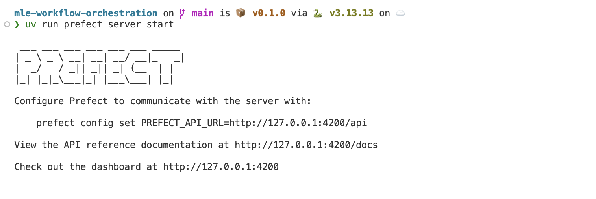
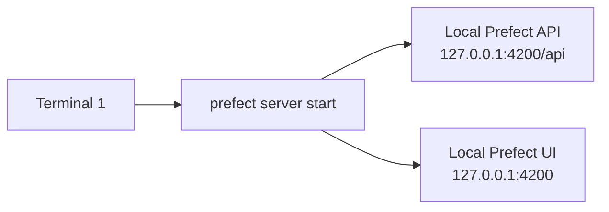
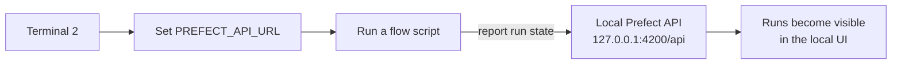
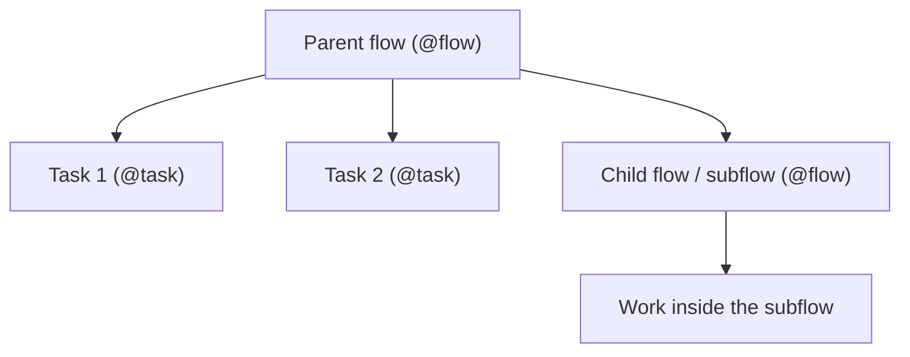
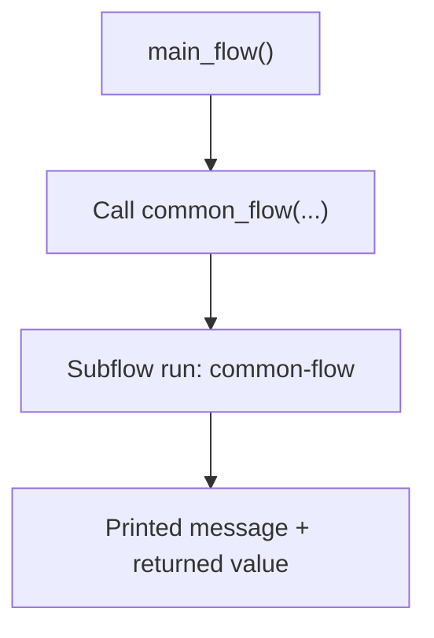
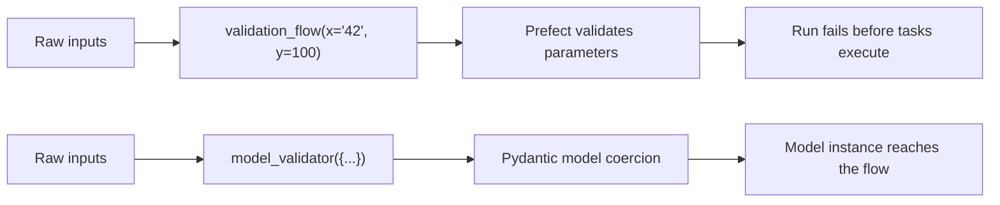
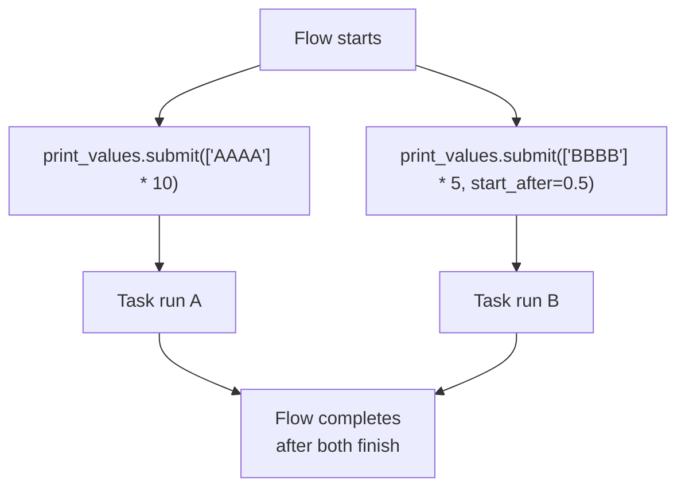

# What is Prefect?

Prefect is a workflow orchestration framework for Python. You write normal Python functions, mark orchestration boundaries with `@flow` and `@task`, and Prefect adds scheduling, retries, state tracking, logging, and a UI for observing runs.  

If you have used a tool like Airflow before, a useful way to think about Prefect is that it is more Python-native and less DAG-first: you keep writing Python code, and Prefect orchestrates it.

## Before you start

As you work through this chapter:

- Run commands from the **project root**.
- You will use two terminals:
  - **Terminal 1** starts the Prefect server in step 1 and stays busy with it for the whole chapter.
  - **Terminal 2** runs every other command.
- Run the example scripts **one at a time**. Running several Prefect examples in parallel can produce noisy temporary-server SQLite lock messages.

> **Note:** If you run a Prefect script without pointing Prefect to a dedicated server, Prefect may start a **temporary local server** automatically. That is normal for quick experiments, but in this chapter we will first set up a dedicated local server so you can also inspect runs in the UI.

## Setup Prefect

### Step 1 — Start a local Prefect server

We will run a **Prefect server locally**. It gives you:

- A **REST API** for flow orchestration and scheduling.
- A **web UI** for monitoring flow runs.

Use **Terminal 1** and start the server:

```bash
uv run prefect server start
```

What to expect:

- The command keeps running in the terminal.
- Prefect starts a local API, scheduler, and UI.
- The UI is available at <http://127.0.0.1:4200>.

You should see logs similar to:  





---

### Step 2 — Point the Prefect client to that server

Once the server is running, Prefect needs to know where to send API requests. You do that by setting `PREFECT_API_URL`.

Use **Terminal 2** and run:

```bash
uv run prefect config set PREFECT_API_URL=http://127.0.0.1:4200/api
```

What to expect:

- Prefect stores the API URL in your active profile.
- Future flow runs from this environment will talk to your local server.

To confirm the setting, run:

```bash
uv run prefect config view
```

You should see `PREFECT_API_URL='http://127.0.0.1:4200/api'` somewhere in the output.

To confirm the API is reachable, open
<http://127.0.0.1:4200/docs>.

That page is the Prefect Swagger UI. If it opens, your local API is reachable.



> **What to notice:** From this point on, scripts you run from the same Python environment will report to your local Prefect server and appear in the UI. If you skip this setup, Prefect may fall back to a temporary server instead.

## Why use workflow orchestration?

Workflow orchestration is the process of managing the order, timing, retries, and observability of a series of tasks. In Data Engineering, that matters because real pipelines do more than "run code once": they download data, call APIs, transform datasets, wait on external systems, and need to be monitored.

Prefect helps you:

- Break a workflow into understandable pieces.
- Retry failed work without rerunning everything.
- Track what ran, when it ran, and whether it succeeded.
- Inspect runs in a UI instead of relying only on terminal output.

## Flows and tasks

**Flows** and **tasks** are the two core building blocks in this chapter.

A [**flow**](https://docs.prefect.io/v3/concepts/flows) is the top-level orchestration unit in Prefect. A flow is a Python function decorated with `@flow`.

A [**task**](https://docs.prefect.io/v3/concepts/tasks) is a smaller unit of work inside a flow. A task is a Python function decorated with `@task`.

In practice:

- A **flow** describes the workflow.
- A **task** describes one step inside that workflow.
- A **subflow** is simply one flow called from another flow.



> **Why this matters:** This structure makes pipelines easier to read, test, retry, and observe. Instead of one large script, you get a workflow with meaningful execution boundaries.

### A first flow

The following example shows a minimal flow. You can find the code in
[src/examples/example01-flow.py](src/examples/example01-flow.py).

```python
from prefect import flow


@flow
def say_hello(name: str):
    print("Hello, world!")
    return f"Hello {name}!"


print(say_hello(name="ML Engineers"))
```

Use **Terminal 2** and run:

```bash
uv run python 01-intro-to-prefect/src/examples/example01-flow.py
```

What to expect:

- Prefect emits flow-run log lines.
- The flow name appears as `say-hello`.
- The run finishes in a `Completed()` state.
- The script prints:
  - `Hello, world!`
  - `Hello ML Engineers!`

If you completed the server setup above, this run should also appear in your local Prefect UI. If you did not, Prefect may start a temporary local server for the run.

> **What to notice:** Adding `@flow` changes the function from "just a Python function" into something Prefect can observe and manage. You still call it like Python, but Prefect now tracks the run.

### Adding tasks

Tasks let you split a workflow into smaller, named units of work. You do not have to use tasks for every line of logic, but using them gives you:

- more granular observability,
- independent retry boundaries,
- better structure for reusable workflow steps.

Here is a simple example that calls a public API. You can find it in
[src/examples/example02-task.py](src/examples/example02-task.py).

```python
import requests
from prefect import flow, task


@task
def call_api(url):
    response = requests.get(url)
    print(response.status_code)
    return response.json()


@task
def parse_fact(response):
    fact = response["fact"]
    print(fact)
    return fact


@flow
def api_flow(url):
    fact_json = call_api(url)
    fact_text = parse_fact(fact_json)
    return fact_text


api_flow("https://catfact.ninja/fact")
```

Use **Terminal 2** and run:

```bash
uv run python 01-intro-to-prefect/src/examples/example02-task.py
```

What to expect:

- Prefect logs one flow run: `api-flow`.
- Prefect logs two task runs: `call_api` and `parse_fact`.
- The script prints:
  - `200`
  - a cat fact returned by the API

> **Warning:** Tasks must be called from within a flow. Tasks may not call other tasks directly.
>
> **What to notice:** The workflow is still simple, but now Prefect can show you which step fetched the API response and which step parsed it. That becomes much more useful as workflows grow.

### Run a flow within a flow

You can call one flow from another flow. The child flow is called a **subflow**.

This is useful when you want to group a chunk of workflow logic and reuse it in
multiple places. You can find the example below in
[src/examples/example03-subflow.py](src/examples/example03-subflow.py).

```python
from prefect import flow


@flow
def common_flow(config: dict):
    print("I am a subgraph that shows up in lots of places!")
    intermediate_result = 42
    return intermediate_result


@flow
def main_flow():
    # Do some things
    # Then call another flow function
    common_flow(config={})
    # Do more things


main_flow()
```

Use **Terminal 2** and run:

```bash
uv run python 01-intro-to-prefect/src/examples/example03-subflow.py
```

What to expect:

- Prefect logs a parent flow run: `main-flow`.
- Prefect logs a child flow run: `common-flow`.
- The child flow is tracked independently in the UI.
- The script prints:
  - `I am a subgraph that shows up in lots of places!`



> **What to notice:** A subflow is not just another helper function. It becomes its own Prefect-tracked run, which means you can inspect it separately from the parent flow.

## Parameter validation and explicit coercion

Prefect validates flow parameters before running the flow body. That means bad inputs can fail a run before any tasks are executed.

The next example intentionally passes the wrong type for `y`. You can find it in [src/examples/example04-type-conversion.py](src/examples/example04-type-conversion.py).

```python
from typing import Any, cast

from prefect import flow, task


@task
def printer(obj: Any) -> None:
    print(f"Received a {type(obj)} with value {obj}")


# Note that we define the flow with type hints
@flow
def validation_flow(x: int, y: str) -> None:
    printer(x)
    printer(y)


raw_x: Any = "42"
raw_y: Any = 100

cast(Any, validation_flow)(x=raw_x, y=raw_y)
```

The `cast(Any, ...)` line is only there so the repo's static type checker does not reject the example file itself. The runtime lesson is that the flow receives
bad input.

Use **Terminal 2** and run:

```bash
uv run python 01-intro-to-prefect/src/examples/example04-type-conversion.py
```

What to expect:

- Prefect starts a flow run for `validation-flow`.
- Parameter validation fails before the tasks run.
- You should see an error similar to:

```text
Flow run received invalid parameters:
 - y: Input should be a valid string
```

Now compare that with the Pydantic-based example in
[src/examples/example05-type-conversion-pydantic.py](src/examples/example05-type-conversion-pydantic.py):

```python
from typing import Any, cast

from prefect import flow, task
from pydantic import BaseModel, ConfigDict


class Model(BaseModel):
    model_config = ConfigDict(coerce_numbers_to_str=True)
    a: int
    b: str
    c: float


@task
def printer(obj: Any) -> None:
    print(f"Received a {type(obj)} with value {obj}")


@flow
def model_validator(model: Model) -> None:
    printer(model)


raw_model: Any = {"a": 42, "b": 0, "c": 55}

cast(Any, model_validator)(raw_model)
```

Use **Terminal 2** and run:

```bash
uv run python 01-intro-to-prefect/src/examples/example05-type-conversion-pydantic.py
```

What to expect:

- The flow run succeeds.
- The printed model shows the coerced values.
- You should see output similar to:

```bash
Received a <class '__main__.Model'> with value a=42 b='0' c=55.0
```



> **What to notice:** Do not rely on accidental conversion. If you want predictable coercion, define it explicitly with a model.

## Flow and task configuration

Flows and tasks accept configuration through decorator arguments. For example, you can set names, descriptions, tags, versions, retries, and retry delays.

```python
@task(
    name="My Task",
    description="This is a task that does something cool!",
    tags=["cool", "awesome"],
)
def my_task():
    pass


@flow(
    name="My Flow",
    description="This is a flow that does something cool!",
    version=1.0,
)
def my_flow():
    pass
```

You can also configure retries:

```python
@task(retries=3, retry_delay_seconds=60)
def my_task():
    pass


@flow(retries=3, retry_delay_seconds=60)
def my_flow():
    pass
```

> **Why this matters:** These settings are how you turn a plain script into a more production-ready workflow. Names improve readability in the UI; retries help with transient failures.

## Task runners

A [**task runner**](https://docs.prefect.io/v3/concepts/task-runners) controls how submitted tasks execute inside a flow.

The key distinction is:

- Calling a task directly runs it sequentially, like a normal Python call.
- Calling `.submit()` hands that task run to the configured task runner.

Prefect includes multiple task runners. The example below uses [`ThreadPoolTaskRunner`](https://docs.prefect.io/v3/api-ref/python/prefect-task_runners#threadpooltaskrunner), which runs submitted tasks in a thread pool and is useful when tasks are I/O-bound. It is also the default task runner, so setting it here only makes that choice visible.

You can find the example in
[src/examples/example06-task-runner.py](src/examples/example06-task-runner.py).

```python
import time
from typing import Any, cast

from prefect import flow, task
from prefect.task_runners import ThreadPoolTaskRunner


@task
def print_values(values: list[str], start_after: float = 0.0) -> None:
    time.sleep(start_after)
    for value in values:
        time.sleep(1)
        print(value, end="\r")


@flow(
    name="My Example Flow",
    task_runner=cast(Any, ThreadPoolTaskRunner()),
)
def my_flow() -> None:
    print_values.submit(["AAAA"] * 10)
    print_values.submit(["BBBB"] * 5, start_after=0.5)


if __name__ == "__main__":
    my_flow()
```

Again, the `cast(Any, ...)` is only there to keep the example file compatible with the repo's static type checker. The important runtime behavior is the use of `.submit()`.

Use **Terminal 2** and run:

```bash
uv run python 01-intro-to-prefect/src/examples/example06-task-runner.py
```

What to expect:

- Prefect starts one flow run.
- Prefect creates two task runs for `print_values`.
- The terminal output flips between `AAAA` and `BBBB` about twice per second. The second task starts half a beat later (`start_after=0.5`) so the two never overwrite each other at the same instant.
- After about 5 seconds the `BBBB` task is done and only `AAAA` keeps updating.
- The flow finishes only after both submitted task runs complete, so it takes about 10 seconds (not 15).



> **What to notice:** `.submit()` is what hands work to the task runner. Without `.submit()`, your tasks run one after another in normal Python order.

## Stopping the server

To stop the Prefect server, go back to **Terminal 1** and press `Ctrl + C`.

If you already closed that terminal and need a fallback, use another terminal to stop Prefect processes:

```bash
# macOS, Linux, Windows Git Bash
pkill -f prefect
```

```PowerShell
# Windows PowerShell
Get-Process prefect -ErrorAction SilentlyContinue | Stop-Process
```

> **Warning:** This will stop **all** Prefect servers running on your machine.

If you start a new server, you will notice all your previous runs, flows, and deployments are still visible. This is because Prefect stores them in a **persistent local database** that is independent of the server process and your Python environment.

If you want a fresh local Prefect database, either delete items manually in the UI or reset the local database with Prefect's own CLI:

```bash
uv run prefect server database reset -y
```

> **Warning:** This removes local Prefect run history, deployments, blocks, and other server metadata for the active Prefect profile.
