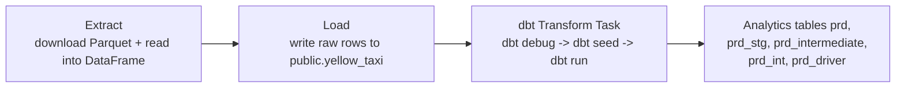
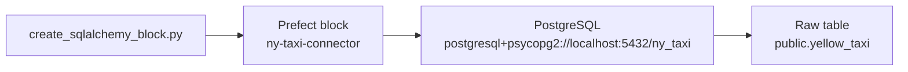
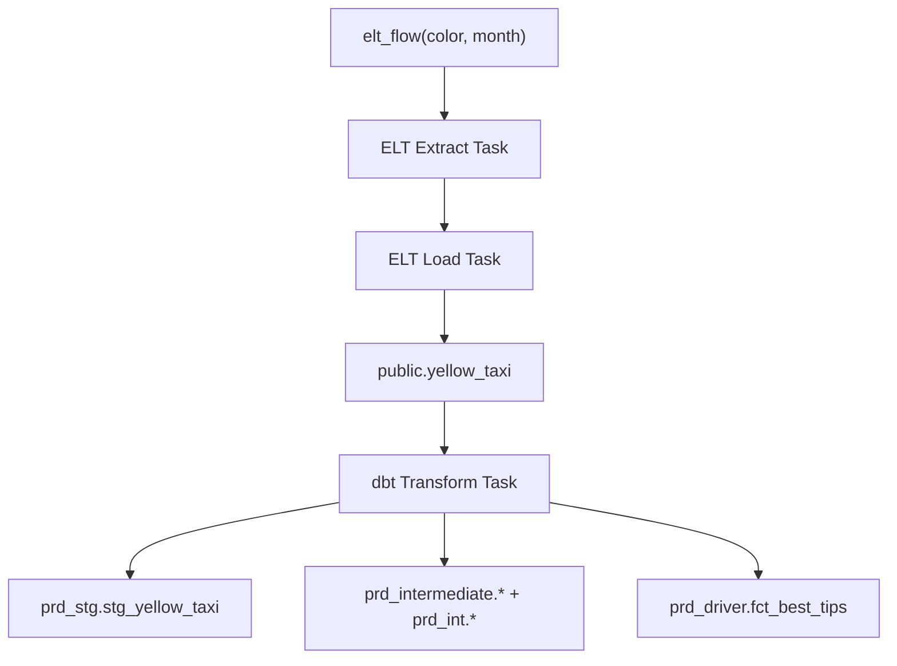
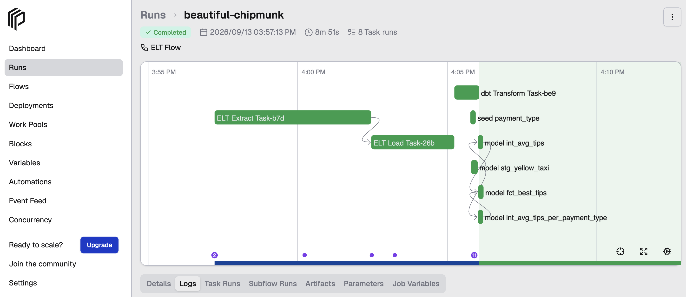
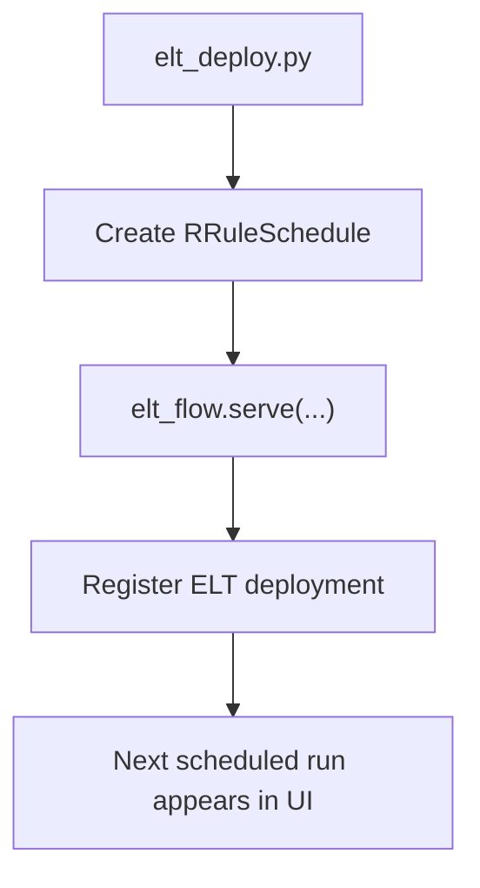

# Build an ELT Pipeline with Prefect and dbt

Now that you have an ETL workflow in place, the next step is to move the transformation logic into dbt and let Prefect orchestrate the whole ELT flow.

The code for this chapter lives in [src/elt_pipe](src/elt_pipe) inside [03-elt-pipeline-with-dbt](.). By the end of this walkthrough, you will be able to:

1. Start the shared local PostgreSQL database from this repository.
2. Reuse the shared Prefect SQLAlchemy block from chapter 2.
3. Run an ELT flow that loads raw data and then transforms it with dbt.
4. Register and serve an ELT deployment in the Prefect UI.

## Before you start

As you work through this chapter:

- Run commands from the **project root**.
- You will use two terminals:
  - **Terminal 1** starts the Prefect server in step 1 and stays busy with it for the whole chapter.
  - **Terminal 2** runs every other command.
  - A third terminal is optional, and only at the very end.
- Make sure Docker Desktop is running.

This chapter is self-contained. It uses the same local PostgreSQL and Prefect setup as chapter 2, but it does not require you to run the ETL chapter first.

The local defaults used throughout this chapter are:

- database: `ny_taxi`
- username: `postgres`
- password: `postgres`
- host: `localhost`
- port: `5432`

> **Note:** The dbt project in this tutorial currently targets the `yellow_taxi` raw table, so the ELT flow supports `color="yellow"` in this chapter.

## What we are building

The ELT workflow in this repository is defined in [src/elt_pipe/elt_pipeline.py](src/elt_pipe/elt_pipeline.py).

It is built from three tasks:

- `extract(...)`
- `load(...)`
- `dbt_task()`

and one flow:

- `elt_flow(color, month)`



> **Why this matters:** In an ETL flow, Python does both loading and transformation. In an ELT flow, Python loads the raw data first and dbt owns the SQL transformations afterward.

## Step 1 — Start the local Prefect server

Use **Terminal 1** and start Prefect:

```bash
uv run prefect server start
```

What to expect:

- The command keeps running.
- Prefect starts a local API and UI.
- The UI is available at <http://127.0.0.1:4200>.

## Step 2 — Point Prefect at that server

Use **Terminal 2** and configure your active Prefect profile:

```bash
uv run prefect config set PREFECT_API_URL=http://127.0.0.1:4200/api
```

To confirm the setting, run:

```bash
uv run prefect config view
```

You should see `PREFECT_API_URL='http://127.0.0.1:4200/api'` in the output.

## Step 3 — Start local PostgreSQL from this repo

Use **Terminal 2** and start PostgreSQL with Docker Compose:

```bash
docker compose up -d
```

To confirm the container is ready, run:

```bash
docker compose ps
```

You should see the `postgres` service in a healthy or running state.

If you want more detail, run:

```bash
docker compose logs postgres
```

> **What to notice:** Chapter 2 and chapter 3 intentionally share the same local database setup. The difference is in the workflow code, not in the infrastructure.

## Step 4 — Create the shared SQLAlchemy block

The ELT flow uses the same Prefect block as the ETL flow:

- Block name: `ny-taxi-connector`

Use **Terminal 2** and run the shared bootstrap script from chapter 2:

```bash
uv run python 02-etl-prefect/src/data_pipe/create_sqlalchemy_block.py
```

What to expect:

- The block is created or overwritten safely.
- The script prints:

```text
Created or updated Prefect block: ny-taxi-connector
```



> **What to notice:** The block is shared infrastructure. Both ETL and ELT can use it without conflicting with each other.

## Step 5 — Understand the dbt project

The dbt assets live entirely under [src/elt_pipe/dbt](src/elt_pipe/dbt):

- Project: [dbt_intro](src/elt_pipe/dbt/project/dbt_intro)
- Profile: [profiles.yml](src/elt_pipe/dbt/profiles/profiles.yml)

The profile is configured to work out of the box with the local Docker PostgreSQL defaults:

```yaml
dbt_intro:
  outputs:
    prod:
      type: postgres
      threads: 4
      host: "{{ env_var('POSTGRES_HOST', 'localhost') }}"
      port: "{{ env_var('POSTGRES_PORT', '5432') | int }}"
      user: "{{ env_var('POSTGRES_USER', 'postgres') }}"
      pass: "{{ env_var('POSTGRES_PASSWORD', 'postgres') }}"
      dbname: "{{ env_var('POSTGRES_DB', 'ny_taxi') }}"
      schema: prd

  target: prod
```

That means:

- No extra environment variables are required for the local tutorial setup.
- You can still override the connection later with `POSTGRES_*` variables if you want to point dbt somewhere else.

The staging source is currently:

```yaml
sources:
  - name: src_yellow_taxi
    schema: public
    tables:
      - name: yellow_taxi
```

> **What to notice:** This is why the tutorial flow currently uses the yellow taxi dataset. The dbt models are explicitly wired to `public.yellow_taxi`.

## Step 6 — Understand the ELT flow

The ELT flow keeps extraction and loading in Python, then hands the transformation step to dbt.

```python
ELT_ROOT = Path(__file__).resolve().parent
REPO_ROOT = ELT_ROOT.parents[2]
DBT_PROJECT_DIR = ELT_ROOT / "dbt" / "project" / "dbt_intro"
DBT_PROFILES_DIR = ELT_ROOT / "dbt" / "profiles"


@task(name="ELT Extract Task", retries=3, retry_delay_seconds=60, log_prints=True)
def extract(url: str, file_path: str) -> pd.DataFrame:
    """This function reads a Parquet file from a given URL and writes it to a local file."""
    Path(file_path).parent.mkdir(parents=True, exist_ok=True)
    urlretrieve(url, file_path)
    df_taxi = pd.read_parquet(file_path)
    return df_taxi


@task(name="ELT Load Task", retries=3, retry_delay_seconds=60, log_prints=True)
def load(df_taxi: pd.DataFrame, file_path: str, table_name: str) -> None:
    """This function loads the raw data into a PostgreSQL database."""
    database_block = cast(
        SqlAlchemyConnector, SqlAlchemyConnector.load("ny-taxi-connector")
    )
    with database_block.get_connection(begin=True) as engine:
        df_taxi.head(n=0).to_sql(
            name=table_name, con=engine, if_exists="replace", index=False
        )

        parquet_file = pq.ParquetFile(file_path)
        for batch in parquet_file.iter_batches(batch_size=100000):
            start_time = time()
            batch_df = batch.to_pandas()
            batch_df.to_sql(f"{table_name}", engine, if_exists="append", index=False)
            end_time = time()
            print("Batch time: ", end_time - start_time)
        print("Finished writing to database!")


@task(name="dbt Transform Task", retries=3, retry_delay_seconds=60, log_prints=True)
def dbt_task() -> Any:
    settings = PrefectDbtSettings(
        profiles_dir=DBT_PROFILES_DIR,
        project_dir=DBT_PROJECT_DIR,
    )
    runner = PrefectDbtRunner(settings=settings)
    return [
        runner.invoke(["debug"]),
        runner.invoke(["seed"]),
        runner.invoke(["run"]),
    ]


@flow(name="ELT Flow")
def elt_flow(color: str, month: int) -> None:
    if color != "yellow":
        raise ValueError(
            "This tutorial dbt project currently supports only color='yellow'."
        )
    ...
```



> **Why this matters:** Python gets the raw data into the warehouse, and dbt takes over from there with versioned SQL models.

## Step 7 — Run the ELT flow

Use **Terminal 2** and run:

```bash
uv run python 03-elt-pipeline-with-dbt/src/elt_pipe/elt_pipeline.py
```

What to expect:

- Prefect starts a flow run named `ELT Flow`.
- The flow creates three task runs:
  - `ELT Extract Task`
  - `ELT Load Task`
  - `dbt Transform Task`
- The Parquet file is downloaded into the repo-level `data/` folder.
- The raw data is loaded into `public.yellow_taxi`.
- dbt runs `debug`, `seed` and `run`.
- Transformed tables are created in schemas such as `prd`, `prd_stg`,
  `prd_intermediate`, `prd_int` and `prd_driver`.

If everything is set up correctly, the flow should finish in a `Completed()` state and appear in the Prefect UI.

Most likely failure modes:

- **Postgres container not running**
  - The flow fails during `ELT Load Task` or `dbt Transform Task`.
- **Prefect server not running**
  - Runs may not appear in the expected local UI.
- **`ny-taxi-connector` block missing**
  - The load step fails before dbt starts.
- **Custom DB environment variables point somewhere invalid**
  - `dbt debug` fails inside `dbt Transform Task`.
- **`color` is not `yellow`**
  - The flow raises a `ValueError` immediately because the tutorial dbt models are wired to the yellow taxi source.

> **What to notice:** This flow is standalone. It loads its own raw data and then runs dbt, so you do not need to populate the raw table with chapter 2 first.



## Step 8 — Create a deployment

Running the ELT flow directly is useful for development. A **deployment** makes it repeatable and schedulable.

The deployment script in this repo is
[elt_deploy.py](src/elt_pipe/elt_deploy.py).

```python
from datetime import UTC, datetime, timedelta

from elt_pipeline import elt_flow
from prefect.client.schemas.schedules import RRuleSchedule

# Start the first run 2 minutes from now, then every 2 months on the same day and time
now = datetime.now(UTC) + timedelta(minutes=2)
rrule_string = (
    f"DTSTART:{now.strftime('%Y%m%dT%H%M%SZ')}\n"
    f"FREQ=MONTHLY;INTERVAL=2;BYMONTHDAY={now.day};BYHOUR={now.hour};BYMINUTE={now.minute}"
)

schedule_rule = RRuleSchedule(rrule=rrule_string, timezone="UTC")

if __name__ == "__main__":
    # Start the flow with a schedule
    elt_flow.serve(
        name="ELT Pipeline",
        schedules=[
            schedule_rule,
        ],
        parameters={"color": "yellow", "month": 1},
        tags=["elt"],
    )
```

What this script does:

- Registers the ELT deployment.
- Serves it locally.
- Schedules the first run about 2 minutes in the future.
- Repeats every 2 months using an RRule.



> **Why this matters:** The flow defines the ELT logic. The deployment defines how that ELT logic is run operationally.

## Step 9 — Run the deployment

Use **Terminal 2** and run:

```bash
uv run python 03-elt-pipeline-with-dbt/src/elt_pipe/elt_deploy.py
```

What to expect:

- The deployment is registered in Prefect.
- The terminal stays open and polls for scheduled runs.
- The first scheduled run should appear in the UI within about 2 minutes.

You should see output similar to:

```text
Your flow 'ELT Flow' is being served and polling for scheduled runs!
```

### Optional: Trigger a run immediately

If you simply wait, the scheduled run starts on its own.

To see a run right away instead, open a third terminal (Terminal 2 is busy serving) and run:

```bash
uv run prefect deployment run 'ELT Flow/ELT Pipeline'
```

> **Note:** Trigger it soon after the deployment starts serving. Otherwise your manual run may overlap with the scheduled one about 2 minutes in, and you will see two runs of the same flow.

Useful UI pages while this is running:

- <http://127.0.0.1:4200/flows>
- <http://127.0.0.1:4200/deployments>
- <http://127.0.0.1:4200/dashboard>

> **Note:** Keep the deployment terminal open. That process is what polls for scheduled runs.

## Common Commands

| Command | Purpose |
| --- | --- |
| `docker compose up -d` | Start the local PostgreSQL dependency |
| `docker compose ps` | Check container status |
| `uv run prefect server start` | Start local Prefect API and UI |
| `uv run prefect config set PREFECT_API_URL=http://127.0.0.1:4200/api` | Point Prefect at your local server |
| `uv run python 02-etl-prefect/src/data_pipe/create_sqlalchemy_block.py` | Create the shared `ny-taxi-connector` block |
| `uv run python 03-elt-pipeline-with-dbt/src/elt_pipe/elt_pipeline.py` | Run the ELT flow directly |
| `uv run python 03-elt-pipeline-with-dbt/src/elt_pipe/elt_deploy.py` | Register and serve the ELT deployment |
| `uv run prefect deployment run 'ELT Flow/ELT Pipeline'` | Trigger the deployment manually |

## Useful local UI URLs

| URL | Purpose |
| --- | --- |
| <http://127.0.0.1:4200/dashboard> | View overall activity and recent runs |
| <http://127.0.0.1:4200/flows> | View registered flows and their runs |
| <http://127.0.0.1:4200/deployments> | View deployments and schedules |
| <http://127.0.0.1:4200/docs> | Open the Prefect API docs |

> **Warning:** These URLs work only while your local Prefect server is running.

## When you are done

Make sure you stop the Prefect processes and the local PostgreSQL container when you finish working with this repository.

First, return to the terminals running `uv run prefect server start` and `uv run python 03-elt-pipeline-with-dbt/src/elt_pipe/elt_deploy.py`, then press `Ctrl + C` in each one.

If you already closed those terminals and need a fallback, stop Prefect processes:

```bash
# macOS, Linux, Windows Git-Bash
pkill -f prefect
```

```PowerShell
# Windows PowerShell
Get-Process prefect -ErrorAction SilentlyContinue | Stop-Process
```

> **Warning:** This stops **all** Prefect processes running on your machine.

Then stop the local PostgreSQL container:

```bash
docker compose down
```

If you also want to delete the local PostgreSQL data volume and start with an empty database next time, run:

```bash
docker compose down -v
```
